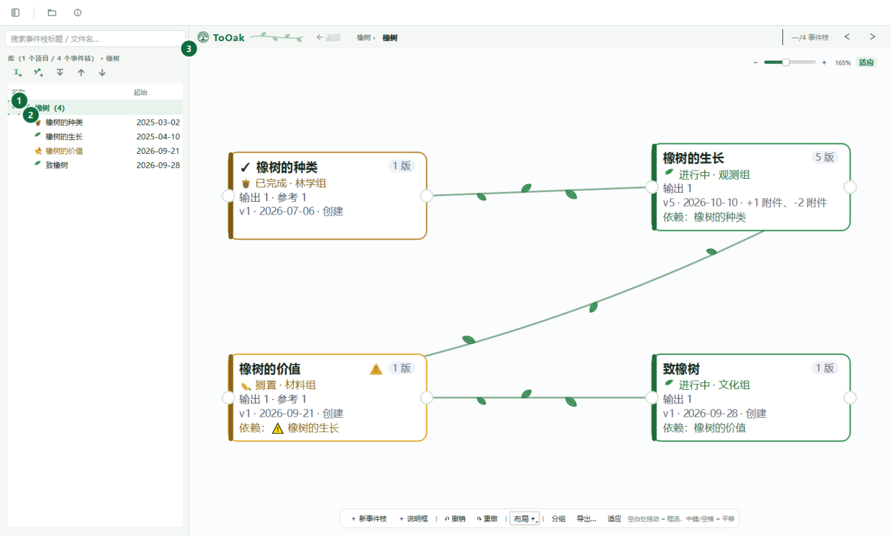
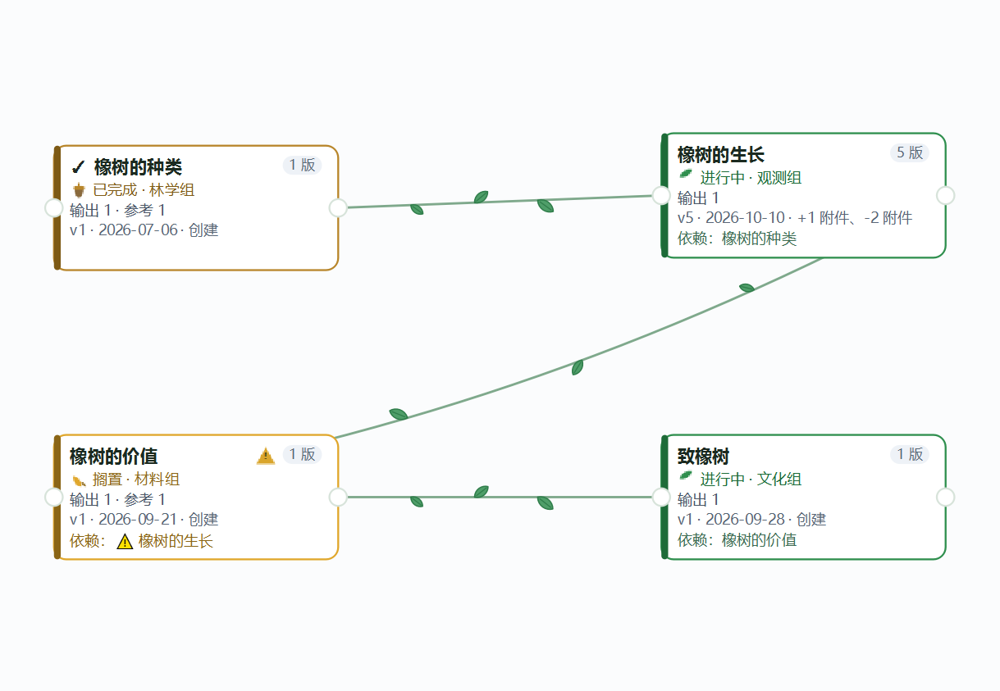
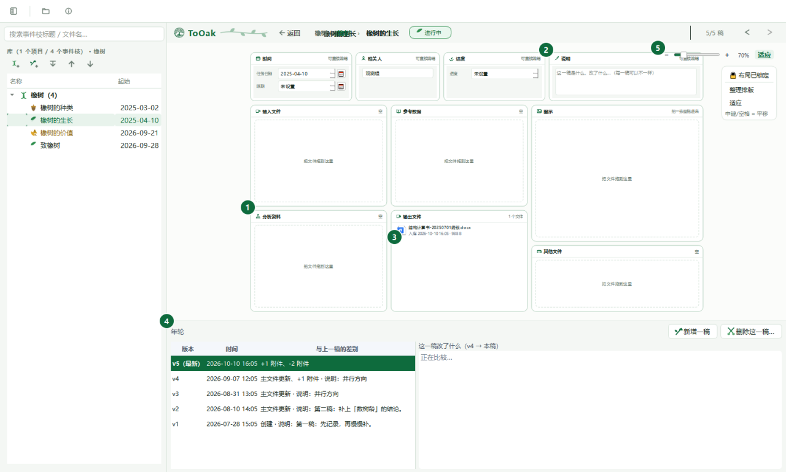
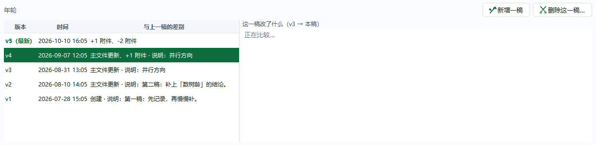
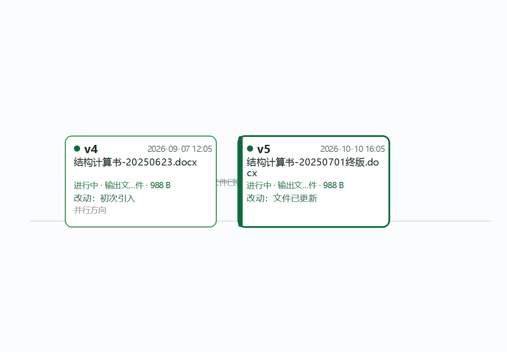

# ToOak · 致橡树

> **这是一个纯粹的「Vibe Coding」能力试验项目。**
> 它由 AI 辅助、按对话逐步搭建而成，用来验证「把想法说清楚，代码跟着长出来」能走多远。
> 项目**仍处于早期阶段**，功能可能不完善、有未覆盖的边界与 bug，界面和数据结构也可能继续调整。
> 欢迎带着好奇心试用、提 issue，但请勿把它当作生产环境里的关键工具。

ToOak 是一个**个人文档 / 项目资料管理器**：把散落在文件夹里的工程资料，
按「项目 → 事件 → 环节 → 文件」整理起来，并记住**同一份资料在不同时期的状态**（版本）。

它诞生于对一个旧版 C++ 桌面程序（Symphytum / ToOak）的重写：保留它「归档不改原文件」
的谨慎，换上一套更贴近「树生长」的心智模型。

## 它是怎么用的（先看这一段）

基本思路是：**把自己的项目拆成不同的环节，给环节之间建立前后依赖关系，用这块白板画出来**。
相应地，不同环节里的各类文档都可以**归档**进去、**不断更新版本**；被依赖的那份文档更新了，
会**提醒**依赖它的那份。你可以在发展逻辑和时间线上**堆分支**，让它像一棵树一样往上长。

**用它替代"文件夹模式"的管理**：文件不再散落在几十层目录里，所有项目文档和"关系"库
（谁依赖谁、哪一稿是谁给的）都在**一个文件夹下** —— 整库拷走就是完整备份，
换机器、留档、交给同事都只要搬这一个目录。

环节不是装饰，它们各自有明确的意思：

| 环节 | 是什么 |
|---|---|
| **输入** | 别人给你的（任务书、需求、上游数据、甲方来件） |
| **输出** | 你自己做出来的（报告、图纸、计算结果、交付件） |
| **参考** | 你自己找的素材，或者"已有的项目文件当初是怎么写的" |
| **分析** | 你在中途解析出来的结果（过程数据、中间结论、试算） |
| **图示** | 一眼看到这张卡就想起来"这是件什么事"的那张图 |
| **说明 / 其他** | 零星记一笔的文字，和放不进上面几类的杂项 |

于是日常就是这几步：**建一根事件枝 → 把文件拖进对应环节 → 改动之后"＋ 新增一稿" →
被依赖的那一根上会自动挂提醒 → 需要回看时翻它的"年轮"（每个环节在各时期分别是什么）。**

## 树生长隐喻

| 术语 | 含义 |
|---|---|
| 项目树 | 一个项目 / 一棵树 |
| 事件枝 | 项目下的一次具体事项（一次要做的「事」） |
| 叶、花、实 | 事件内部的固定槽位：输入 / 分析 / 输出 / 参考 / 图示 / 说明 / 其他，某个环节某一稿里的具体文件 |
| 年轮 | 版本控制：同一个环节在不同时期分别是哪些文件 |

## 核心特点

- **绝不动你的原文件**：归档是把文件**复制**进库（`files/<别名>/<原始文件名>`），
  不移动、不删除、不改写；删除在 ToOak 里是「修剪 / 归档」，原文件永远还在磁盘上。
- **库就是一个目录**：索引 + 文件副本 + 依赖关系全在里面，整库拷走即完整备份 ——
  换机器、留档、交给同事都只搬这一个目录。
- **按「环节」而不是按文件名做版本链**：文件名每稿都在变（`提交_v2.docx` → `提交-终版.docx`），
  ToOak 记住的是"这个交付物在不同时期分别是什么"，并给出每一稿相对上一稿的真实差异
  （文本逐行比；Word / Excel / PPT 先抽正文再比）。
- **上一稿有、这一稿还没认下的文件会留在页面上**（灰色「未登记」行），右键一键
  **复制一份进这一稿** —— 库里真的多一份实体文件，不是链接、也不与原来那稿共用。
- **白板即依赖图**：事件枝是卡片，依赖是你自己画的线；被依赖的那根出了新稿、自己还没跟，
  卡片上挂琥珀色 ⚠（知道了可以「忽略本次依赖告警」，上游再出新稿时它自己回来）。
- **用 Word / WPS 自己比较**：右键 Word 文件 →「用 Word 比较」，调本机「审阅 → 比较」，
  生成一份**带修订标记**的文档并直接打开（格式、表格、页眉页脚、批注都在）；名字改过也配得上。
- **事件枝可以分组，也能折起来**：一组收成标题栏那一条，位置一个都不改；
  分组与折叠状态在左边那棵树里同步可见。
- **命令行与桌面端共用同一个内核**：归档、检索、导出、体检、旧库迁移都能脚本化。

## 演示库

第一次用，建议先跑一份**橡树演示数据**：一个「橡树」项目，四根事件枝
（种类 → 生长 → 价值 → 致橡树）串成一条依赖链，其中「生长」有两稿并分叉出两个并行方案，
「致橡树」的输出文件是舒婷《致橡树》全诗。看一眼就知道年轮和依赖图长什么样。

## 界面一览

下面这些是**程序自带演示库**的真实截图（一棵「橡树」、四根事件枝）。




左边是项目树与它下面的事件枝，右边是这块项目的**白板**：事件枝是一张张卡片（随你摆，摆过就存库），
按住卡片两侧的小圆点拖到另一张卡片 = 连一条依赖线。



**事件页**：环节方框（拖文件进去就归档到这一稿的这个环节）+ 信息框（时间 / 相关人 / 进度 / 说明）
+ 文件卡片，底部是这一枝的「年轮」。



**年轮**：每一稿一行（最新在最上），写着与上一稿的差别（创建 / 主文件更新 / +N 附件…）
和这一稿的说明文字；点一行就把画面切到那一稿，右边同时算"这一稿改了什么"。



某个**环节**的年轮：这个交付物在各时期分别是哪一稿。

### 右键菜单里的两件事


**用 Word 比较**：Word 文件才有这一项 —— 挑一稿当"原文"，调**本机 Word 的「审阅 → 比较」**，
生成一份**带修订标记的文档**（格式、表格、页眉页脚、批注都在）并直接在 Word 里打开；
结果另存一份在 `<库>/exports/word-compare/`。名字改过也配得上（去掉日期、版本号、"提交/终版"
这类噪音之后按相似度认）。


**复制一份到这一稿**：上一稿有、这一稿还没认下的文件留着灰行（标着「未登记」）——
右键那一行就能把它**真复制一份进库**（`files/<别名>/<原名>`，与原来那份各管各的）。
往哪一稿加很直白：「添加文件到「××」…」是往**现在看的这一稿**加，
「加入到某一稿（复制一份）→」是复制一份到**别的某一稿**。

## 快速开始

需要 **Python ≥ 3.11**（开发环境为 3.14）与 **PySide6**。
```bash
# 造一份演示数据再打开（空库时）
python run.py --demo -L ~/我的库

# 打开已有库
python run.py -L ~/我的库

# 或直接跑打包好的启动脚本（单实例、日志、缺依赖提示等小事它都管）
./tooak.sh
```

首次启动没有库时，会引导你**选一个空间较大的位置**存放库，并提示阅读内置说明文档。

### 从旧版本升上来

用新版打开旧版建的库时，程序**先问一句**再动它：这个库要升级结构（比如 v15 → v20）、
只做"加列 / 建表"这类事、你的事件枝与年轮一条都不会动，但升级**不可逆** ——
升完之后旧版 ToOak 会拒绝打开这个库。框里给三条路：
**先备份再升级**（一键把整个库目录拷到旁边，带进度条）/ 直接升级 / 先不动退出。
命令行那条路（`tooak … -L 老库`）没有界面，会在升级前往 stderr 写一句同样的提醒。
所以升级前请务必留一份库目录的副本 —— 这不是客套，是唯一的退路。

## 命令行

```bash
python -m tooak.cli -L ~/我的库 <子命令> [参数]

tree                       # 项目 / 事件树
projects / project-add     # 列出 / 新建项目
node-add                   # 项目下加分类节点
add 报告.docx --node 某工程/结构设计   # 归档文件
log 报告                   # 看一份文档的版本历史
stages 报告 --chains       # 各环节 + 每个环节的稿
state 报告 --set done      # 状态：进行中 / 已完成 / 搁置
note 报告 "改图注"         # 给最新一稿记说明
export 报告                # 导出成文件夹（含清单）
verify                     # 体检：文件还在不在、还是不是当初那份
rebind --search <目录> --deep --apply   # 修失效引用
relocate --old X --new Y --apply        # 数据目录搬家
file-mode                  # 看归档方式（默认 copy：复制进库）
legacy-import --from /path/旧库         # 从旧版 Symphytum/ToOak 迁入
```

不带子命令时会列出全部可用命令；每个子命令 `-h` 有详细说明。

## 架构

```
tooak/
  core/            内核：不依赖任何 GUI，桌面端与 CLI 共用
    db.py          SQLite 结构 + 版本化迁移
    library.py     业务语义：项目 / 事件 / 环节 / 版本 / 依赖 / 自检 / 重定位
    store.py       文件纳管：复制进库（默认）/ 就地引用
    diffing.py     文本抽取与差异（txt/docx/xlsx/pptx）
    wordcompare.py 调本机 Word 的「审阅 → 比较」（PowerShell + COM，无第三方依赖）
    versiongraph.py 版本图（年轮）：DAG + 时间轴布局
    exporter.py    批量导出
    watcher.py     目录监视 → 自动版本
    legacy.py      旧版 Symphytum / ToOak 库读取与迁移
  desktop/         PySide6 桌面端
  cli.py           命令行工具
  demo.py          橡树演示库
```

内核独立，是刻意的：数据只有一份、语义只有一套，界面怎么换都不会出现「同步冲突」。

## 打包发布

```powershell
# 版本号在 tooak/version.py 的 VERSION；发布包按 ToOak-<版本>-win-x64-portable 命名
$repo = 'D:\…\ToOak'
& "$env:LOCALAPPDATA\Programs\Python\Python312\Scripts\pyinstaller.exe" `
    -w -n ToOak -i "$repo\tooak\desktop\assets\tooak.ico" `
    --add-data "$repo\tooak\desktop\assets;tooak\desktop\assets" `
    --noconfirm --distpath "$repo\dist" --workpath "$repo\build" "$repo\run.py"
```

那条 `--add-data`是**必须带**的：程序运行时靠 `tooak/resource.py` 从 `sys._MEIPASS`
里取这些资源 —— 少了它，界面里的「说明」打不开（内置 PDF 没了）、图标是空的：

| 打包进去的位置 | 里面是什么 |
|---|---|
| `tooak/desktop/assets/` | 程序图标（`.ico` / `.png`）与**内置说明 PDF** |

`tooak.spec` 里也写了这一行（`datas`）。注意 **PyInstaller 从 `.py` 生成 spec 会把
`datas` 清空**，而 `-n ToOak` 生成的 `ToOak.spec` 在 Windows 上会覆盖同名的
`tooak.spec` —— 所以要么像上面那样显式带 `--add-data`，要么直接用 `pyinstaller tooak.spec`，
要么换个目录跑那条命令，别让生成出来的 spec 把仓库里这份覆盖掉。

## 已知限制

- 大批量归档在后台串行执行，没有取消按钮。
- 图片 / 图纸目前只比元数据与哈希，没有像素级 / 几何级比较。
- 「用 Word 比较」要本机安装 Microsoft Word（Windows）；没装时菜单项在但置灰，
  并写明原因。比较结果只是生成一份文档，**不会**在库里记一条"比较过"的记录。
- 目录监视能力内核仍在，但界面入口暂未开放。

## 许可证

MIT 许可证，见 [LICENSE](LICENSE)。
